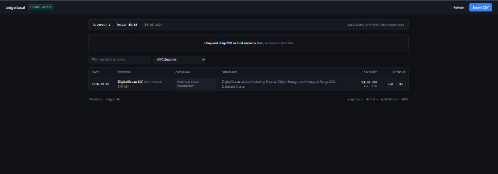

# LedgerLocal

A lightweight, 100% offline invoice and receipt parser for freelancers. Runs on your own machine with Ollama. Zero cloud calls, zero monthly subscriptions.



---

## Why I Built This

Every tax season or quarter-end, freelancers and consultants go through the exact same headache: a folder full of random PDF invoices, Uber receipts, client coffee stubs, and software bills. 

The existing tools usually fall into two traps:
1. **Expensive SaaS subscriptions ($25-$40/mo):** Bloated accounting platforms you only touch four times a year.
2. **Privacy risks:** Most "smart" parsers upload your documents to a cloud server. If your invoices contain client NDAs, project descriptions, or card slips, sending them to an unvetted third party is a dealbreaker.

**LedgerLocal** runs locally on your machine using open-weight models (powered by Google's `gemma2:2b`, with support for `phi4-mini` and `llama3.2-vision`) through [Ollama](https://ollama.ai).

- **100% Offline:** Works without an internet connection.
- **Zero API Bills:** Process 10 or 1,000 receipts without paying per-token charges.
- **Privacy by Default:** Files never leave `localhost`.
- **Editable Dashboard:** Interactive web UI allows instant verification and edits before exporting to CSV for your accountant.

---

## Quickstart

### Prerequisites

1. **Python 3.10+**
2. **Ollama installed & running:**
   ```bash
   ollama pull gemma2:2b
   ```

### Installation

```bash
git clone https://github.com/alessiobianchini/ledgerlocal.git
cd ledgerlocal

pip install -r requirements.txt
```

### Running the Web Dashboard

```bash
python run.py
```

Open `http://localhost:8000` in your browser. Drag & drop your receipts into the window.

### Terminal CLI Usage

If you prefer working from the terminal:

```bash
# Process all files in a folder
python -m src.cli import ./sample_data

# View your expense ledger
python -m src.cli list

# View summary stats by category and currency
python -m src.cli stats

# Export to CSV
python -m src.cli export -o expenses.csv
```

---

## Deduction Categories

Transactions are automatically classified into standard expense categories:
- Software & Subscriptions
- Hosting & Cloud Infrastructure
- Hardware & Office Supplies
- Travel & Transportation
- Meals & Client Entertainment
- Professional & Legal Services
- Marketing & Advertising
- Utilities & Internet
- Other

---

## License

MIT License. Built for the Hacktoberfest 2026 Open-Source AI Challenge.
